# Awesome Productivity & Workplace Collaboration 🚀

  

  <b>A rigorously curated index of leading SaaS suites and sovereign open-source alternatives for real-time team collaboration, multiplayer documents, knowledge bases, no-code relational databases, infinite visual whiteboards, and AI-native workplaces.</b>

---

## 📑 Table of Contents
- [🌐 Sector Overview & Market Dynamics](#-sector-overview--market-dynamics)
- [💼 SaaS & Enterprise Hosted Platforms](#-saas--enterprise-hosted-platforms)
- [🔓 Open-Source GitHub Projects](#-open-source-github-projects)
- [🧩 Frameworks & Sovereign Stack Recipes](#-frameworks--sovereign-stack-recipes)
- [🤝 How to Contribute](#-how-to-contribute)
- [⭐ Star History](#-star-history)
- [💖 Support & Sponsorship](#-support--sponsorship)
- [📜 Disclaimer](#-disclaimer)

---

## 🌐 Sector Overview & Market Dynamics

The global workplace and team collaboration software market is estimated at **$25B to $48B** (projected to reach **$90B–$140B+ by 2032** at an annual growth rate of ~10–11.4%). The sector remains **moderately to highly fragmented**—while horizontal platform monoliths (Microsoft 365 / Teams and Google Workspace) anchor baseline communication, organizations routinely deploy best-of-breed point solutions (Slack, Notion, Miro, Asana, Monday.com, Airtable) to satisfy distinct departmental workflows, accelerating demand for unifying AI agents, universal search, and modular sovereign stacks.

---

## 💼 SaaS & Enterprise Hosted Platforms

The table below catalogs top SaaS productivity platforms sorted in **descending order of company scale (market capitalization or private valuation)**.

| Platform | Starting Price (Paid Tier) | Free Tier Limit / Policy | Company Size (Valuation / Market Cap / Scale) | Core Capabilities |
| :--- | :--- | :--- | :--- | :--- |
| **[Microsoft Teams](https://microsoft.com/microsoft-teams)** | **$4.00** /user/month (Teams Essentials) | **Free Forever Plan**: Up to 100 participants per meeting, 60-minute maximum group meeting limit, 5 GB cloud storage per user, and unlimited 1:1 chat. | **~$3,100 Billion ($3.1T)** Market Cap *(Microsoft)* | Enterprise workplace collaboration hub combining team chat, video conferencing, audio calling, and native Microsoft 365 app integrations. |
| **[Slack](https://slack.com)** | **$7.25** /user/month (Pro plan, billed annually) | **Free Forever Plan**: 90-day searchable message and file history (messages >1 year purged), 10 app integrations, and 1:1 audio/video huddles. | **$27.7 Billion** Acquisition Valuation *(Salesforce)* | Channel-based messaging, huddles, automated workflows, and ecosystem integrations connecting cross-functional teams. |
| **[Notion](https://notion.so)** | **$10.00** /user/month (Plus plan, billed annually) | **Free Forever Plan**: Unlimited blocks and pages for solo users; up to 10 external guests; 1,000 blocks lifetime cap if 2+ workspace members are added. | **$11.0 Billion** Valuation *(Private tender / secondary market)* | All-in-one connected workspace integrating collaborative documents, wikis, relational databases, sprint tracking, and AI knowledge search. |
| **[ClickUp](https://clickup.com)** | **$7.00** /user/month (Unlimited plan, billed annually) | **Free Forever Plan**: Unlimited tasks and members; 100 MB total workspace storage; 100 lifetime uses for Custom Fields, Gantt charts, and Dashboards; 100 automation runs/month. | **$4.0 Billion** Valuation *(Series C private valuation)* | Highly customizable Work OS uniting tasks, nested docs, whiteboards, dashboards, goals, and team chat into one suite. |
| **[Monday.com](https://monday.com)** | **$9.00** /seat/month (Basic plan, billed annually; 3-seat minimum) | **Free Forever Plan**: Up to 2 seats, hard cap of 200 total items/records across the account, up to 3 boards, 500 MB storage, and zero automations/integrations. | **~$3.4 Billion** Market Cap *(NASDAQ: MNDY)* | Visual work management system enabling teams to construct agile boards, workflow automations, CRM pipelines, and executive dashboards. |
| **[Airtable](https://airtable.com)** | **$20.00** /user/month (Team plan, billed annually) | **Free Forever Plan**: Up to 5 editors, 1,000 records per base, 1 GB file attachments per base, and 100 automation runs per month. | **$2.25 Billion** Valuation *(Acquired by Bending Spoons; peak private valuation $11.7B)* | Relational database and no-code application builder combining flexible spreadsheet interfaces with automated workflows and data views. |
| **[Asana](https://asana.com)** | **$10.99** /user/month (Starter plan, billed annually) | **Free Forever Plan (Personal)**: Up to 2 users/seats for new workspaces; unlimited projects, tasks, and activity logs; 100 MB per file limit. | **~$2.1 Billion** Market Cap *(NYSE: ASAN)* | Collaborative work management platform tracking team projects, strategic initiatives, dependencies, Gantt timelines, and agile workloads. |
| **[Miro](https://miro.com)** | **$8.00** /member/month (Starter plan, billed annually) | **Free Forever Plan**: Up to 3 active editable boards across the team (older boards switch to view-only); unlimited team members; core template library. | **$1.79 Billion** Equity Valuation *(Acquired by Bending Spoons; peak private valuation $17.5B)* | Real-time infinite visual canvas for team brainstorming, system diagramming, sprint retrospectives, wireframing, and interactive workshops. |
| **[Coda](https://coda.io)** | **$10.00** /Doc Maker/month (Pro plan, billed annually; Editors & Viewers are always free) | **Free Forever Plan**: Unlimited Doc Makers and collaborators; doc size constrained by memory/attachment limits (1 GB workspace storage limit); 35 unbillable automation actions/month. | **$1.4 Billion** Valuation *(Acquired by Grammarly / Superhuman; Series D valuation $1.4B)* | Blended document-spreadsheet environment with interactive controls, formula-driven tables, and third-party SaaS Pack integrations. |
| **[Basecamp](https://basecamp.com)** | **$15.00** /user/month (or **$299.00**/month Pro Unlimited flat fee) | **Free Trial**: 30-day full-featured free trial (no credit card required); **Basecamp Personal**: Free forever limited strictly to 3 users and 1 active project. | **Bootstrapped / ~$50M–$100M ARR** *(37signals; zero venture funding, highly profitable)* | Opinionated, distraction-free team workspace combining message boards, to-dos, schedules, group chats, automatic check-ins, and Hill Charts. |

---

## 🔓 Open-Source GitHub Projects

The table below catalogs premier open-source workplace and productivity repositories, sorted in **descending order of GitHub star count**. Each repository badge links directly to its live stargazers page.

| Project & Repo | Description & Architecture | GitHub Stars |
| :--- | :--- | :---: |
| **[Excalidraw](https://github.com/excalidraw/excalidraw)**  | Virtual hand-drawn style collaborative whiteboard and system diagramming tool with end-to-end encrypted multiplayer canvas. | 136,200+ |
| **[AppFlowy](https://github.com/AppFlowy-IO/AppFlowy)**  | Privacy-first open-source Notion alternative built with Flutter and Rust for offline-first personal notes, team wikis, and Kanban databases. | 79,400+ |
| **[AFFiNE](https://github.com/toeverything/AFFiNE)**  | Next-generation all-in-one collaborative workspace merging structured block documents, relational tables, and an infinite whiteboard. | 77,700+ |
| **[NocoDB](https://github.com/nocodb/nocodb)**  | Free, self-hostable Airtable alternative that connects to MySQL, PostgreSQL, SQL Server, and SQLite to create collaborative smart spreadsheets. | 65,600+ |
| **[Plane](https://github.com/makeplane/plane)**  | Modern open-source project and work management platform offering Cycles, Modules, Kanban boards, Gantt timelines, and collaborative Pages. | 63,000+ |
| **[tldraw](https://github.com/tldraw/tldraw)**  | Lightweight infinite collaborative canvas SDK and digital whiteboard built for fast visual thinking, wireframing, and browser-based sketching. | 51,500+ |
| **[SiYuan](https://github.com/siyuan-note/siyuan)**  | Privacy-first, self-hosted personal and team knowledge workspace featuring bidirectional linking, block-level refs, and end-to-end sync. | 47,300+ |
| **[Rocket.Chat](https://github.com/RocketChat/Rocket.Chat)**  | Secure open-source communications platform supporting team chat, Matrix federation, video calls, and omnichannel customer messaging. | 46,500+ |
| **[Logseq](https://github.com/logseq/logseq)**  | Local-first, privacy-respecting outliner and knowledge base for team documentation, task tracking, whiteboards, and interconnected notes. | 45,600+ |
| **[Outline](https://github.com/outline/outline)**  | Fast, beautiful open-source team knowledge base and wiki featuring multiplayer real-time markdown editing, Slack integration, and SSO. | 41,300+ |
| **[Mattermost](https://github.com/mattermost/mattermost)**  | Enterprise-grade open-source team messaging, playbook automation, and secure collaboration platform alternative to Slack and Teams. | 39,600+ |
| **[Nextcloud Hub](https://github.com/nextcloud/server)**  | Self-hosted sovereign content collaboration suite uniting file storage/sync, real-time Talk chat/video, Office editing, and groupware calendars. | 37,600+ |
| **[Jitsi Meet](https://github.com/jitsi/jitsi-meet)**  | Secure, simple, and scalable open-source WebRTC video conferencing and meeting platform serving as a private alternative to Zoom. | 30,200+ |
| **[Huly](https://github.com/hcengineering/platform)**  | All-in-one open-source workplace platform unifying team messaging, Linear-like project tracking, documents, and virtual workspaces. | 28,100+ |
| **[Focalboard](https://github.com/mattermost-community/focalboard)**  | Open-source, self-hosted multilingual project and task management board alternative to Trello, Notion boards, and Asana. | 26,500+ |
| **[Zulip](https://github.com/zulip/zulip)**  | Powerful open-source team chat combining real-time messaging with structured stream/topic email-like threading for asynchronous distributed teams. | 26,200+ |
| **[OpenWork](https://github.com/different-ai/openwork)**  | Open-source AI-native collaborative workspace and autonomous agent environment designed to coordinate execution and team knowledge. | 24,500+ |
| **[Docmost](https://github.com/docmost/docmost)**  | Open-source collaborative wiki and documentation suite featuring real-time multiplayer editing, nested spaces, and embedded Excalidraw diagrams. | 22,400+ |
| **[Wekan](https://github.com/wekan/wekan)**  | Battle-tested open-source Kanban board platform for agile task management, team card distribution, and workflow tracking. | 21,100+ |
| **[Element](https://github.com/element-hq/element-web)**  | Decentralized, end-to-end encrypted workplace messenger client built on the open Matrix communication protocol. | 13,600+ |
| **[Planka](https://github.com/plankanban/planka)**  | Lightweight, elegant open-source Kanban board for tracking projects and organizing team tasks with real-time updates. | 12,700+ |
| **[CryptPad](https://github.com/cryptpad/cryptpad)**  | Zero-knowledge end-to-end encrypted collaborative suite for rich text documents, spreadsheets, code, Kanban, and whiteboards. | 8,100+ |
| **[ONLYOFFICE Docs](https://github.com/ONLYOFFICE/DocumentServer)**  | Self-hosted collaborative online office suite offering real-time co-authoring for OOXML documents, spreadsheets, and presentations. | 7,100+ |
| **[Baserow](https://github.com/baserow/baserow)**  | Open-source no-code database and Airtable alternative with visual tables, forms, galleries, and automations backed by PostgreSQL. | 6,300+ |
| **[Vikunja](https://github.com/go-vikunja/vikunja)**  | Open-source, self-hosted to-do list and task management suite for organizing cross-functional team workflows and personal priorities. | 6,100+ |

---

## 🧩 Frameworks & Sovereign Stack Recipes

Building a privacy-first, vendor-independent collaboration stack? Consider these production-proven open-source combinations:

- **Unified Messaging & Communications**: Deploy **Mattermost** or **Zulip** connected with **Jitsi Meet** for secure internal chat, video calls, and screen sharing.
- **Enterprise Wiki & Multi-User Docs**: Pair **Outline** or **AFFiNE** with **ONLYOFFICE DocumentServer** to provide document co-authoring and knowledge management.
- **Relational Databases & Spreadsheets**: Integrate **NocoDB** or **Baserow** over PostgreSQL to replace proprietary Airtable workflows.
- **Visual Brainstorming & Whiteboards**: Self-host **Excalidraw** or embed **tldraw** directly inside web dashboards for sprint retrospectives and architecture sketches.
- **AI-Powered Workplace Orchestration**: Connect **OpenWork** with local Ollama LLMs or MCP connectors to build an autonomous workplace workspace.

---

## 🤝 How to Contribute

Contributions to this directory are warmly encouraged!

1. **Fork** the repository on GitHub.
2. Add or refine an entry in `README.md` maintaining alphabetical or star/valuation-sorted order.
3. Ensure pricing numbers, free tier limits, and GitHub URLs are verified against official documentation.
4. Submit a **Pull Request** with a concise description of your additions.

Please review our [Awesome Guidelines](https://github.com/ishandutta2007/Awesome-Awesome-Awesome) for quality benchmarks.

---

## ⭐ Star History

#

---

## 💖 Support & Sponsorship

If you find this curated directory valuable for your team, organization, or open-source infrastructure:

- ⭐ **Star** this repository to help other developers and teams discover it!
- 🍴 **Fork** it and build your own sovereign workplace stack.
- 📢 **Share** it across LinkedIn, X (Twitter), Reddit, or developer forums.
- ☕ **Sponsor**: Support ongoing maintenance and curation via the [GitHub Sponsors Dashboard](https://github.com/sponsors/ishandutt22007).

Your support keeps this directory independent, accurate, and up to date! ✨

---

## 📜 Disclaimer

- This repository is a **community-curated directory** intended for informational, research, and technical comparison purposes. Brand names, logos, and trademarks belong to their respective copyright holders.
- Self-hosted workplace suites process confidential corporate communication and documents. Always secure deployments with TLS encryption, Single Sign-On (SSO/OIDC), network isolation, and automated backup strategies.

---

  Maintained with ❤️ for distributed teams, software engineers, DevOps architects, and sovereign open-source workplace advocates.

